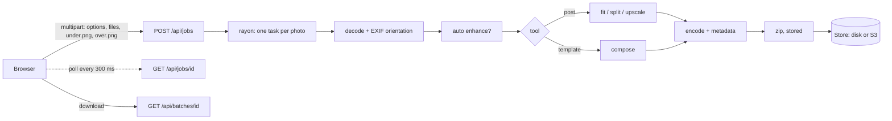

# Post Enhancer

Batch photo export for social posts and photoshoots. Drop finished photos in, get files sized and encoded for Instagram and Facebook, carousel panels cut without losing a pixel, or every photo laid out on a branded frame with a title, logo and watermark.

A single Rust binary (Axum) serves one static page and does all image work server-side. It runs as a Finder-launchable Mac app on `127.0.0.1`, or as a container behind a shared password on AWS App Runner with S3 for history.

> The window and the Mac app are labelled **Post Prep**; the repository is **Post Enhancer**.

- **Platform exports.** Instagram and Facebook sizes, center-cropped to the exact pixel target, Lanczos3 downscaled, JPEG 4:4:4 with the source ICC profile kept.
- **Carousel split.** Cut a wide photo into N panels of a chosen ratio. The photo is padded to fit, never cropped, and the panels re-stitch byte for byte to the padded canvas.
- **Template frames.** Any canvas (3:4 default), with padding, border, rounded corners, shadow, four background modes, title, credit, logo and a corner, center or tiled watermark. Saved templates export as JSON.
- **PNG frame.** Bring your own transparent PNG (a border, a watermark, a full frame). Every photo goes behind it with no automatic layout, and the export is the PNG's size.
- **Upscaling.** Lanczos plus unsharp mask everywhere; Real-ESRGAN ×4 on the GPU in the Mac app.
- **Formats.** JPEG, PNG, WebP, TIFF, BMP and GIF in. On macOS also HEIC, AVIF and camera RAW through `sips`.
- **Batch tools.** Auto enhance, rename tokens, `Artist`/`Copyright`/`Software` metadata on every file, live per-photo progress, re-downloadable history.

## Contents

- [Quick start](#quick-start)
- [Using the app](#using-the-app)
- [Output reference](#output-reference)
- [How it works](#how-it-works)
- [HTTP API](#http-api)
- [Configuration](#configuration)
- [Deploy to AWS](#deploy-to-aws)
- [Development](#development)
- [Limits and notes](#limits-and-notes)
- [License](#license)
- [Credits](#credits)

## Quick start

Requires Rust 1.85 or newer (edition 2024). The Mac app also needs macOS with `sips`, `iconutil`, `curl` and `python3` (Xcode Command Line Tools provide it).

```bash
git clone https://github.com/cGradying/post-enhancer.git
cd post-enhancer
```

**Mac app (opens from Finder):**

```bash
./make-app.sh
```

This builds the release binary, downloads Real-ESRGAN's official macOS release once (pinned to a SHA-256, kept in `vendor/`), and installs `/Applications/Post Prep.app` (or `~/Applications` if `/Applications` isn't writable; set `APP_DIR` to choose). Open it from Finder, Launchpad or Spotlight. It starts a local server on `127.0.0.1:4870` with no password and opens your browser. Batches are kept in `~/Library/Application Support/Post Prep/batches/`, and the server log is `server.log` in `Post Prep/`.

The server keeps running after you close the tab. Stop it with:

```bash
pkill -f 'Post Prep.app/Contents/.*photo-post-prep'
```

Rerun `./make-app.sh` after pulling changes; it stops the old server first.

**From source:**

```bash
cargo run --release          # http://localhost:8080
```

## Using the app

Drag photos anywhere onto the window, paste with ⌘V, or use **Choose photos**. Use ← and → to switch photos and Delete to remove one. Settings save in your browser as you change them.

### Post Prep tab

1. **Sizes.** Tick the outputs you want. Hovering a size highlights its tile in the preview, drawn exactly as it will be cropped. **Upscaled original** adds a ×2 or ×4 copy of the whole photo.
2. **Carousel split** (optional). Turn it on, set the number of columns (**Best fit** picks the count needing the least padding) and the panel shape (1:1, 4:5, 3:4 or custom). Pick the padding color. With **Only split wide photos** on, anything narrower than 1.5:1 is skipped, so a mixed batch only splits the panoramas. The preview shows the cut lines and every panel.
3. Pick **JPEG** or **PNG** and an **Upscale** mode, then **Export**.

### Template tab

At the top of the panel, **Layout** builds a frame for you (padding, text, watermark). **PNG frame** skips all of that and uses your own artwork. Switching between them keeps both sets of settings.

#### PNG frame

1. Choose **PNG frame**, then **Choose PNG**. Use a PNG with a transparent area where the photo should show. Soft edges, shadows and partly transparent pixels are kept exactly, because the file goes to the server unchanged.
2. The canvas becomes the PNG's pixel size, so a 1080×1350 frame exports 1080×1350 photos. Nothing is padded, rotated or laid out.
3. **Fill** crops each photo to cover the whole frame. **Fit** shows the whole photo and fills the rest with a color or a blurred copy of the photo.
4. **Save** it like any template. The PNG is saved inside the template, and **•••** exports it as a `.postprep.json` file you can load on another machine. A very large PNG may be too big for browser storage, in which case it still exports but is not remembered after a reload.

Photos smaller than the frame are scaled up with the Upscale mode you pick. With Upscale off, a **Fit** photo stays at its native size and is flagged in the preview, while a **Fill** photo is always scaled to cover the frame.

#### Layout

1. **Layout.** Choose a canvas (3:4, 4:5, 1:1, 4:3, 16:9 or custom; **Rotate** swaps orientation). **Fit photo** shows the whole photo inside the frame; **Fill frame** crops to fill it. **Padding** insets the photo on all sides; **Text space** adds room only where a title or credit line exists.
2. **Style.** Background is a solid color, a blurred copy of the photo, the purple pixel fade, or your own image. Add a border, rounded corners and a shadow.
3. **Text & logo.** Title and credit line, font, color, alignment and size. Add a logo and place it on a 3×3 grid.
4. **Watermark.** Off, corner, center or tiled at 30°, as text or the logo, with size and opacity.
5. **Save** the template from the bar at the top of the panel. **•••** exports it as a `.postprep.json` file, imports one, or deletes it. Templates live in browser storage, so export a file to share one.
6. **One / All** in the top bar switches between a single large preview and a grid of the whole batch in the template. Click a tile to open that photo.

### Export options (both tabs)

The dock at the bottom holds the format and upscale mode. **More options** holds:

| Option | Effect |
|---|---|
| JPEG quality | 70–100, default 95 |
| Auto enhance | Levels stretch, gentle contrast curve, light sharpen |
| Event | Fills the `{event}` token |
| File names | Pattern for output names, see below |
| Artist, Copyright | Written into every file's metadata (defaults `cgradying`, `© cgradying`) |

**Upscale** applies when a photo is smaller than its output slot: **Off** keeps native size, **Auto** uses Lanczos plus sharpening, **AI** uses Real-ESRGAN (only shown when the server has it).

Rename tokens: `{name}` original name, `{event}`, `{date}` (YYYY-MM-DD), `{n}` or `{n:03}` for a zero-padded counter, `{preset}` output id. The default is `{name}_{preset}`. Names are sanitized to letters, digits, `.`, `_` and `-`, and duplicates get `-2`, `-3`.

Export uploads the batch, shows `n / total` while it processes, then delivers the result.

**Save to.** In the Mac app the export panel has a **Save to** folder. **Choose…** opens the macOS folder picker, or type a path like `~/Downloads/Post Prep`. Each export is saved in its own sub-folder named with the date and time, for example `Post Prep 2026-10-31 1724/instagram/IMG_0001_ig_portrait.jpg`. Files are written as each photo finishes, existing files are never overwritten, and the **Show in Finder** link under the status opens the folder. The folder must be inside your home folder or on an external drive. Tick **Download one zip instead of saving files** to get a zip. On a hosted deployment there is no folder option, only the zip.

**Big batches.** Photos go up in parts of at most 80 files or 250 MB, one part at a time, so a few hundred photos no longer exceed the upload limit. Numbering with `{n}` carries on across parts. A part that drops is retried twice before the export stops, and a zip export downloads one zip per part. **History** in the top bar re-downloads earlier zip batches.

## Output reference

| Id | Folder | Size |
|---|---|---|
| `ig_portrait` | `instagram/` | 1080×1350 (4:5) |
| `ig_tall` | `instagram/` | 1080×1440 (3:4) |
| `ig_square` | `instagram/` | 1080×1080 |
| `ig_landscape` | `instagram/` | 1080×566 |
| `ig_story` | `instagram/` | 1080×1920 |
| `fb_feed` | `facebook/` | 2048 px long side, ratio kept |
| `fb_story` | `facebook/` | 1080×1920 |

Other zip folders: `split/` (`{name}_{i}of{n}`, each panel scaled to 1080 wide), `upscaled/` (`{name}_x2`, `_x4`) and `template/` (`{name}_framed`). Files that fail to decode are listed in `errors.txt` and don't stop the batch.

Every JPEG is progressive, 4:4:4, quality 95 by default, with the source ICC profile and an EXIF block holding `Software: Post Prep by cgradying`, `Artist` and `Copyright`. PNG output carries the same fields as text chunks. Original camera EXIF is not copied.

## How it works



```text
src/
├── main.rs       routes, login gate, multipart intake, job spawn
├── jobs.rs       options, progress registry, per-photo pipeline, zip, rename
├── media.rs      decode (+ sips fallback), SIMD resize, cover crop, JPEG/PNG encode, EXIF
├── split.rs      carousel splitter (pure, unit-tested)
├── template.rs   frame compositor
├── upscale.rs    Lanczos and Real-ESRGAN
├── enhance.rs    auto levels / contrast / sharpen
└── store.rs      batch storage: ./data or S3
static/           index.html, app.css, app.js, template.js, fonts/  (embedded in the binary)
```

**Decode.** The `image` crate reads JPEG, PNG, WebP, TIFF, BMP and GIF (first frame) and the ICC profile and EXIF orientation are applied up front. If that fails on macOS, the file is converted to PNG with `sips` (ImageIO), which is how HEIC, AVIF and RAW are read. Pixels are held as 8-bit RGB; no color conversion is done, the profile is just carried through.

**Fit.** The target ratio is cropped from the center, then resized with `fast_image_resize` (Lanczos3, SIMD). If the crop is narrower than the target and upscaling is on, it is scaled up to the exact size; with upscaling off the crop is kept at native size rather than blown up.

**Carousel split.** For `cols` panels of ratio `rw:rh` the canvas ratio is `cols·rw : rh`. Whichever side of the photo is short is padded, the photo is centered, and cuts fall at `floor(i·W / cols)`. Panel widths differ by at most one pixel and a unit test checks that the panels stitch back to the canvas exactly.

**Templates.** The browser draws the two layers that need fonts and vector shapes (background, and title/logo/watermark) at full canvas size and uploads them as PNGs, so the preview and the export use the same text rendering. The server places the photo in the slot (contain or cover, rounded corners with anti-aliasing, optional shadow and border), draws the background `under` it and composites `over` on top. A blurred-photo background is rendered server-side at 1/8 scale.

**Upscaling.** Lanczos is `fast_image_resize` plus an unsharp mask (σ 0.8, threshold 2). AI runs `realesrgan-ncnn-vulkan -s 4 -n realesrgan-x4plus` on the cropped source, then Lanczos settles the exact size. GPU runs are serialized with a mutex, and any failure falls back to Lanczos.

**Enhance.** Luminance is stretched between its 0.5th and 99.5th percentile, 25 % of a smoothstep curve is blended in, the same lookup table is applied to R, G and B so hues don't shift, then the image is sharpened lightly.

**Jobs.** `POST /api/jobs` returns an id immediately. A worker runs photos in parallel with rayon, bumping a counter that `GET /api/jobs/{id}` reports. Finished zips are written to the store under a millisecond-timestamp id. Finished job records are pruned once they are 10 minutes old, the next time a job is created. Zips use the `Stored` method since JPEG and PNG don't compress further.

## HTTP API

The page is the only client, but the API is plain HTTP. Behind a password, log in first (`POST /login`, form field `password`) and send the `session` cookie.

| Route | Description |
|---|---|
| `POST /api/jobs` | Multipart: `options` (JSON), `files` (repeatable), optional `under` and `over` (PNG layers, template only). Returns `{"id": "…"}`. |
| `GET /api/jobs/{id}` | `{"state":"running","done":3,"total":12}`, then `{"state":"done","batch_id":"…"}`, `{"state":"saved","folder":"…","files":780}` when `out_dir` was used, or `{"state":"failed","error":"…"}`. |
| `GET /api/batches` | Batch ids, newest first. |
| `GET /api/batches/{id}` | The zip. |
| `POST /api/preview` | Multipart `file`; returns a JPEG of at most 1600 px, with the source size in `x-source-size`. Used for formats browsers can't display. |
| `GET /api/capabilities` | `{"ai_upscale": bool, "heic": bool, "version": "…", "local": bool, "can_choose": bool, "default_dir": "…"}` |
| `POST /api/choose-folder` | Opens the macOS folder picker. Returns `{"path": "…"}` or `{"cancelled": true}`. |
| `POST /api/reveal` | `{"path": "…"}` opens that folder in Finder. |

`out_dir`, `/api/choose-folder` and `/api/reveal` only work when the server is bound to `127.0.0.1` (the Mac app), and only for requests from the app's own page: the request needs the header `X-Post-Prep: 1`, and `Host` and `Origin` must be `localhost` or `127.0.0.1` on the server's port. Other pages in your browser cannot make the app write to your disk.

`options` fields are all optional; `layout` is required when `tool` is `template`. `offset`, `out_dir` and `out_name` are how the page splits a big export:

```jsonc
{
  "tool": "post",                      // "post" | "template"
  "presets": ["ig_portrait", "fb_feed"],
  "split": { "cols": 3, "rw": 4, "rh": 5, "pad": "#ffffff", "wide_only": true },
  "originals": 2,                      // add an upscaled copy: 2 or 4
  "layout": { /* template only, see below */ },
  "format": "jpeg",                    // "jpeg" | "png"
  "quality": 95,                       // 60–100, JPEG only
  "upscale": "lanczos",                // "off" | "lanczos" | "ai"
  "enhance": false,
  "offset": 0,                         // photos handled by earlier parts of this export, so {n} keeps counting
  "out_dir": "~/Downloads/Post Prep",  // local Mac app only: save files here instead of building a zip
  "out_name": "Post Prep 2026-10-31",  // sub-folder made inside out_dir, shared by every part
  "rename": "{event}_{n:03}",
  "event": "summit",
  "date": "2026-10-23",
  "meta": { "artist": "cgradying", "copyright": "© cgradying" }
}
```

`layout` (template): `w`, `h` canvas size; `slot {x,y,w,h}` where the photo goes; `cover`, `border`, `border_color`, `radius`, `shadow`, `blur_bg`, `bg_color`.

Example with `curl` against the Mac app:

```bash
ID=$(curl -s -F 'options={"tool":"post","presets":["ig_tall","fb_feed"],"upscale":"lanczos"}' \
          -F files=@IMG_0412.jpg -F files=@IMG_0413.heic \
          http://127.0.0.1:4870/api/jobs | sed 's/.*"id":"\([0-9]*\)".*/\1/')

until curl -s http://127.0.0.1:4870/api/jobs/$ID | grep -q '"state":"done"'; do sleep 0.5; done
curl -s -o batch.zip http://127.0.0.1:4870/api/batches/$ID
```

## Configuration

| Variable | Default | Meaning |
|---|---|---|
| `PORT` | `8080` | Listen port |
| `HOST` | `0.0.0.0` | Bind address (the Mac app uses `127.0.0.1`) |
| `APP_PASSWORD` | unset | Shared login password; unset means no login |
| `S3_BUCKET` | unset | Store batches in S3 (`batches/{id}.zip`); unset means local disk |
| `DATA_DIR` | `data` | Local batch folder |
| `MAX_UPLOAD_MB` | `1024` | Upload limit per request |
| `REALESRGAN_BIN` | unset | Path to `realesrgan-ncnn-vulkan` to enable AI upscaling outside the Mac app |

AWS credentials come from the standard provider chain. Set `APP_PASSWORD` only when serving over HTTPS: the session cookie is `Secure`, `HttpOnly` and `SameSite=Strict`.

## Deploy to AWS

`deploy.sh` provisions App Runner with a private S3 bucket. It needs the AWS CLI v2 signed in and Docker running.

```bash
AWS_REGION=ap-southeast-1 ./deploy.sh
```

On first run it creates a private, public-access-blocked bucket, an ECR repository, two IAM roles (ECR pull, and S3 read/write on that one bucket), and an App Runner service on 1 vCPU / 2 GB. It then prompts for the shared password. Later runs push a new image and redeploy. The service is pinned to one instance because login sessions are held in memory.

The container is a multi-stage build (`rust:1-bookworm`, then distroless). It has no `sips` and no Real-ESRGAN, so HEIC, AVIF, RAW and AI upscaling are unavailable there, and the UI hides them via `/api/capabilities`.

## Development

```bash
cargo run --release              # dev server
cargo test                       # 15 unit tests
```

The tests cover the splitter's lossless stitch, preset sizes, upscale-or-keep behavior, JPEG/PNG round trips with metadata, EXIF offsets, template placement, rounded corners, rename tokens, duplicate names, Lanczos factors and enhance. The static files are compiled in with `include_str!`, so rebuild after editing them.

## Limits and notes

- A zip export holds each part's inputs and outputs in memory, so budget RAM for about 250 MB of photos plus their outputs. Saving to a folder writes each photo as it finishes and keeps only a few photos in memory. A single photo larger than `MAX_UPLOAD_MB` is rejected.
- Only the first frame of an animated GIF is read. Output is 8-bit.
- Auth is a single shared password with no rate limiting. Don't expose it to the open internet unprotected.
- Template previews draw a blurred-photo background approximately; the export renders the real blur.
- Saved templates and settings live in browser storage and are not synced.

## License

[MIT](LICENSE) © 2026 cgradying. Third-party fonts, the Real-ESRGAN engine and Rust crates keep their own licenses, listed under Credits.

## Credits

Made by [cgradying](https://github.com/cGradying). The visual design follows [pixel-id-maker](https://github.com/cGradying/pixel-id-maker).

- Fonts: Silkscreen and Space Grotesk, SIL Open Font License 1.1, served from `static/fonts/`.
- AI upscaling: [Real-ESRGAN](https://github.com/xinntao/Real-ESRGAN) (BSD-3-Clause) through its `realesrgan-ncnn-vulkan` build. It is downloaded by `make-app.sh` and is not stored in this repository; see its project for license terms.
- Rust crates: `axum`, `tokio`, `image`, `fast_image_resize`, `jpeg-encoder`, `png`, `rayon`, `zip`, `aws-sdk-s3`.
